# 从 RAW 到 RGB：手写 ISP 全流程（C++ 教学工程）

> 一门按 **RAW 域 → RGB 域 → YUV 域** 组织的 ISP 实践课。
> 输入是**真实的 16bit 无头 RAW**（Bayer + `.meta`），
> 输出是 RGB PNG（可选 YUV420）。
> 20 个目录 = 20 节课，每个阶段都能单独编译、单独运行、单独观察。

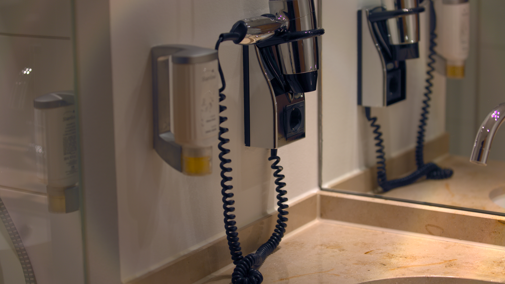

---

## 0. 先跑起来

```bash
cd /home/lchin/ISP_Raw_Course
./build.sh
./run_pipeline.sh
```

输出：

```text
out/final.png   2880×1620，sRGB，8bit
```

本机单线程约 **13 秒**（5760×3840 输入，峰值内存约 580 MB）。

想一步一步看：

```bash
./run_pipeline.sh --keep      # 一次跑完，保存 out/stage/*.isp
./run_pipeline.sh --steps     # 20 个 stage 分别跑，走 out/steps/
```

单看某一阶段：

```bash
./build/isp_dump out/stage/06_demosaic.isp out/06.png
./build/isp_info out/stage/06_demosaic.isp
```

---

## 1. 这门课解决什么问题

相机传感器输出的是 **Bayer RAW**：每个像素只有 R/G/B 中的一个颜色，
而且数据是线性的、带黑电平、带暗角、带噪声。它不能直接显示。

ISP（Image Signal Processor）要做的，就是：

```text
单通道 Bayer
   ↓ 修数据（RAW 域）
   ↓ 算颜色（RGB 域）
   ↓ 修观感（YUV 域）
能显示、能压缩的彩色图像
```

本工程把这条链路拆成 **20 个 stage**，每个 stage 一个目录、一个函数、一个 CLI。
你可以只改其中一步，再编译，立刻看到差异。

---

## 2. 输入：为什么是 `.raw` + `.meta`

### 2.1 `.raw` 只有像素

```text
data/sample.raw
5760 × 3840
16bit little-endian
无文件头
单通道 Bayer（RGGB）
= 5760 × 3840 × 2 = 44,236,800 字节
```

纯 `.raw` 没有宽高、CFA、黑电平、白平衡。ISP 必须先读 `.meta`：

```text
width 5760
height 3840
bayer RGGB
black 2047 2047 2047 2048
white 15000
wb 1.649 1.000 2.165
cam_to_xyz 0.7385 -0.0108 0.2229 ...
camera Canon EOS 5D Mark III
```

少一个字段，ISP 就只能猜。工业上这些信息可能在传感器寄存器、驱动或
DNG/EXIF 里；教学工程把它显式写出来，方便手改参数做实验。

### 2.2 示例数据从哪来

`sample.raw` 来自一张真实的 Canon 5D3 未压缩 DNG：
把 DNG 的 Bayer 负载原样导出成无头 `.raw`，并记录 meta。
运行时**不解析 DNG**；DNG 只在制作数据时出现一次。

来源与许可见 [`data/README.md`](data/README.md)。

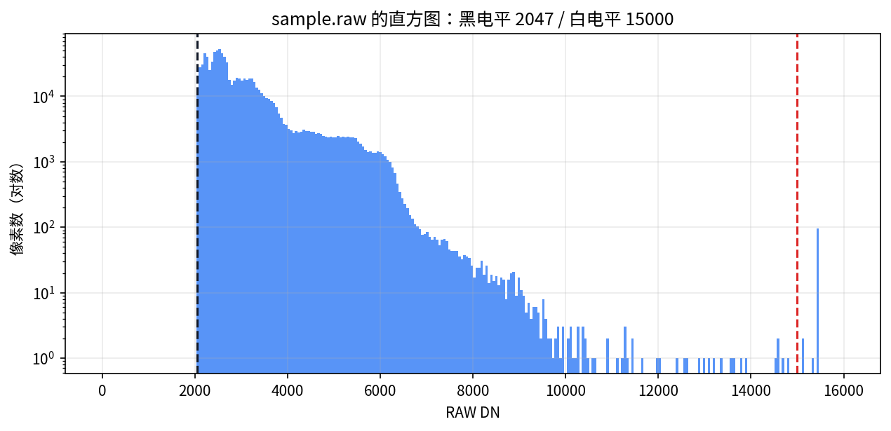

黑电平 2047、白电平 15000。左侧的尖峰就是“没光也有读数”的偏置。

### 2.3 风景示例：`landscape.raw`

为了演示真实的蓝天、草地、树木场景，新增了：

```text
data/landscape.raw     3088×2056，16bit little-endian，RGGB
data/landscape.meta    Canon EOS D60：black 127/127/126/127，white 4000
```

来源是 raw.pixls.us 的 **Canon EOS D60 RAW (3:2)** 样本（CC0），
用 rawpy 从 CRW 的 `raw_image_visible` 直接导出 Bayer 数据，不是从 RGB 反推。
原 `sample.raw` / `sample.meta` **没有覆盖**。

```bash
./build/isp_pipeline --raw data/landscape.raw --meta data/landscape.meta   --out out/landscape/final.png
```

输出 1544×868，单线程约 3 秒。风景工程动画就是用这套实际 stage 图生成的。

---

## 3. 整条流水线

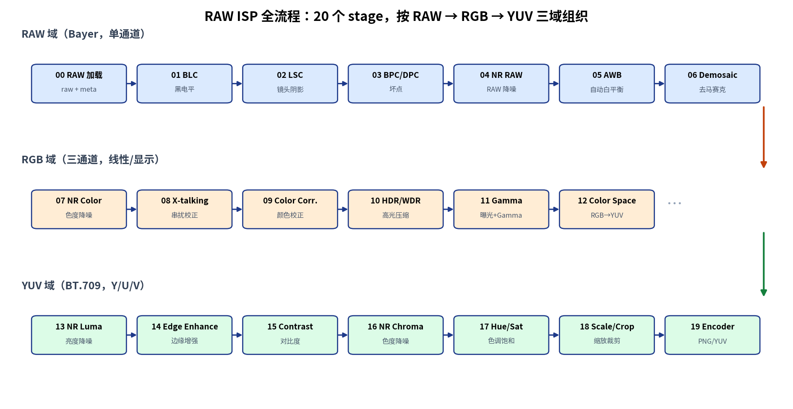

一张图看 20 步的变化：

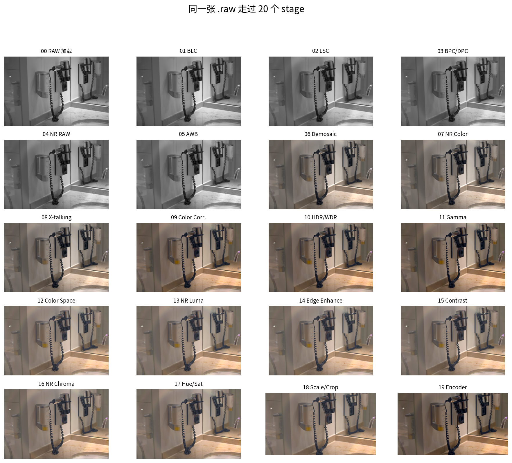

> 前 7 步是灰度，因为数据还是单通道 Bayer；
> stage 06 之后才是 RGB；stage 12 之后进入 YUV。
> 这不是 bug，是 ISP 的三个域。

### 3.1 阶段总表

| # | 目录 | 做什么 | 关键概念 | 对比 | 讲义 |
|---|------|--------|----------|------|------|
| 00 | `stages/00_raw_load` | `.raw + .meta` → Bayer | 无头 RAW、CFA、黑白电平、字节序 | [图](docs/images/stage_00.png) | [读](stages/00_raw_load/README.md) |
| 01 | `stages/01_blc` | 黑电平校正、归一化 | 光学黑、暗电流、DN、下溢 | [图](docs/images/compare_01.png) | [读](stages/01_blc/README.md) |
| 02 | `stages/02_lsc` | 镜头阴影校正 | 暗角、cos⁴、径向增益、flat-field | [图](docs/images/compare_02.png) | [读](stages/02_lsc/README.md) |
| 03 | `stages/03_dpc` | 坏点校正 | hot/dead pixel、同色邻域、中值 | [图](docs/images/compare_03.png) | [读](stages/03_dpc/README.md) |
| 04 | `stages/04_nr_raw` | RAW 域降噪 | 光子噪声、双边滤波、同色采样 | [图](docs/images/compare_04.png) | [读](stages/04_nr_raw/README.md) |
| 05 | `stages/05_awb` | 自动白平衡 | 色温、灰度世界、AsShotNeutral | [图](docs/images/compare_05.png) | [读](stages/05_awb/README.md) |
| 06 | `stages/06_demosaic` | 去马赛克 | 双线性、Malvar-He-Cutler、伪彩 | [图](docs/images/compare_06.png) | [读](stages/06_demosaic/README.md) |
| 07 | `stages/07_nr_color` | RGB 域色度降噪 | YUV、色度中值、亮度保持 | [图](docs/images/compare_07.png) | [读](stages/07_nr_color/README.md) |
| 08 | `stages/08_xtalk` | 颜色串扰校正 | 滤光片串扰、3×3 矩阵、行归一化 | [图](docs/images/compare_08.png) | [读](stages/08_xtalk/README.md) |
| 09 | `stages/09_color_correction` | 相机 RGB → sRGB | CCM、XYZ、Bradford、ForwardMatrix | [图](docs/images/compare_09.png) | [读](stages/09_color_correction/README.md) |
| 10 | `stages/10_hdr_wdr` | 高光压缩 | 宽动态、soft-knee、高光恢复 | [图](docs/images/compare_10.png) | [读](stages/10_hdr_wdr/README.md) |
| 11 | `stages/11_gamma` | 自动曝光 + Gamma | 线性光、sRGB 传输函数、分位数曝光 | [图](docs/images/compare_11.png) | [读](stages/11_gamma/README.md) |
| 12 | `stages/12_color_space` | RGB → YUV | BT.709、full range、Y/U/V | [图](docs/images/compare_12.png) | [读](stages/12_color_space/README.md) |
| 13 | `stages/13_nr_luma` | 亮度降噪 | 双边、σ、细节保持 | [图](docs/images/compare_13.png) | [读](stages/13_nr_luma/README.md) |
| 14 | `stages/14_edge_enhance` | 边缘增强 | unsharp mask、Y-only、白边 | [图](docs/images/compare_14.png) | [读](stages/14_edge_enhance/README.md) |
| 15 | `stages/15_contrast_brightness` | 对比度/亮度 | Y 通道、线性对比度、死黑 | [图](docs/images/compare_15.png) | [读](stages/15_contrast_brightness/README.md) |
| 16 | `stages/16_nr_chroma` | 色度降噪 | U/V 中值、色度渗色 | [图](docs/images/compare_16.png) | [读](stages/16_nr_chroma/README.md) |
| 17 | `stages/17_hue_saturation` | 色相/饱和度 | 色度旋转、饱和度、肤色 | [图](docs/images/compare_17.png) | [读](stages/17_hue_saturation/README.md) |
| 18 | `stages/18_scale_crop` | 缩放、裁剪 | box 缩放、16:9、重采样 | [图](docs/images/compare_18.png) | [读](stages/18_scale_crop/README.md) |
| 19 | `stages/19_encoder` | PNG / YUV420 输出 | 量化、YUV→RGB、4:2:0 | [图](docs/images/compare_19.png) | [读](stages/19_encoder/README.md) |

### 3.2 前后对比图集

每一张都是“上一阶段 → 本阶段”，同一张 `.raw`、同一次流水线。

<details>
<summary><b>RAW 域：00 → 06</b></summary>

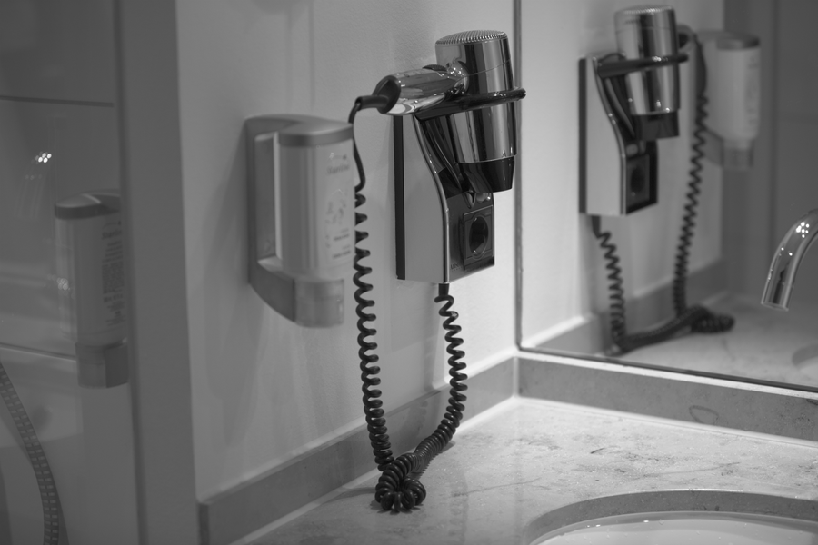
*00 RAW 加载：单通道 Bayer。*


*01 BLC：减黑电平，暗部不再带偏置。*

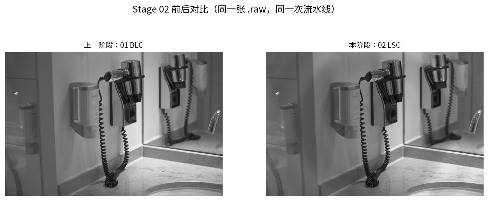
*02 LSC：四角提亮。*

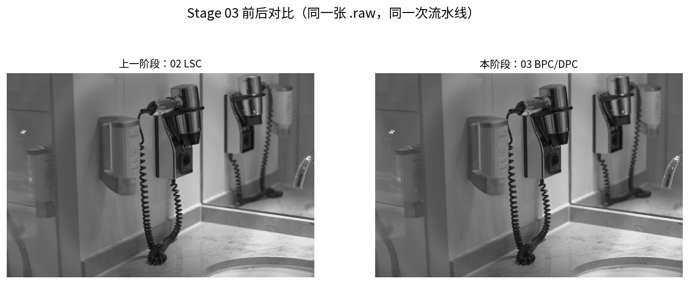
*03 BPC/DPC：坏点被同色中值替换。*

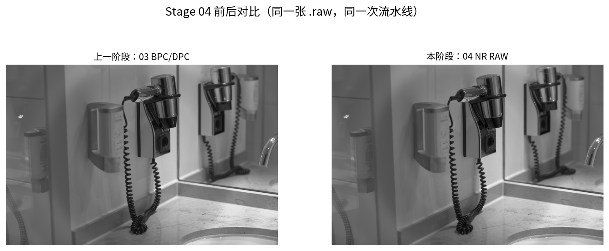
*04 NR RAW：RAW 域双边降噪。*


*05 AWB：三通道增益对齐。*

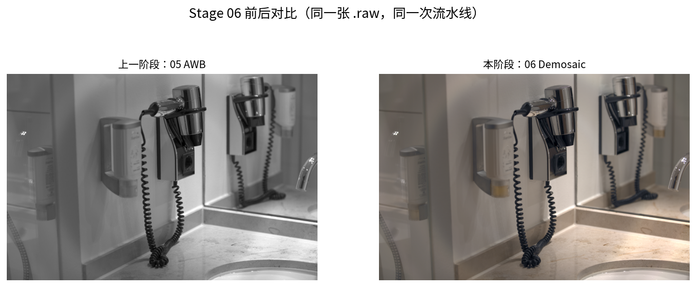
*06 Demosaic：单通道变三通道。*

</details>

<details>
<summary><b>RGB 域：07 → 12</b></summary>


*07 NR Color：色度中值。*

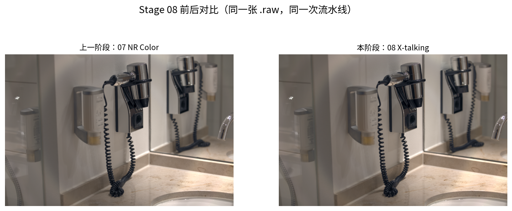
*08 X-talking：串扰校正。*

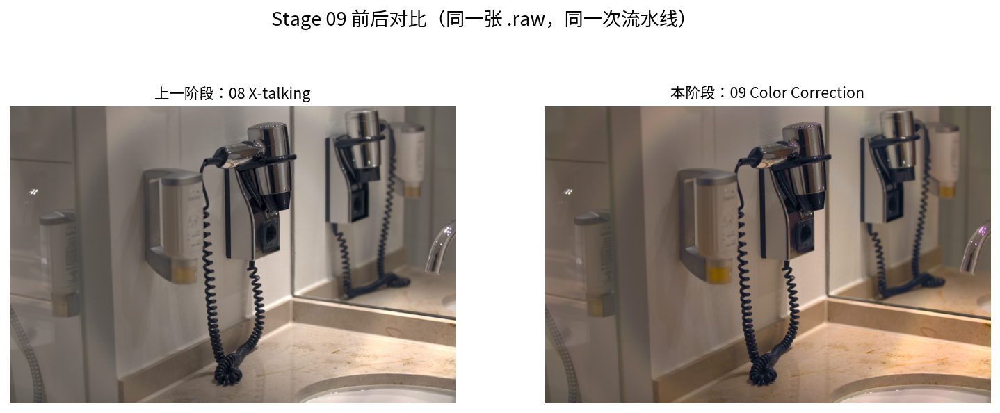
*09 Color Correction：相机 RGB → linear sRGB。*

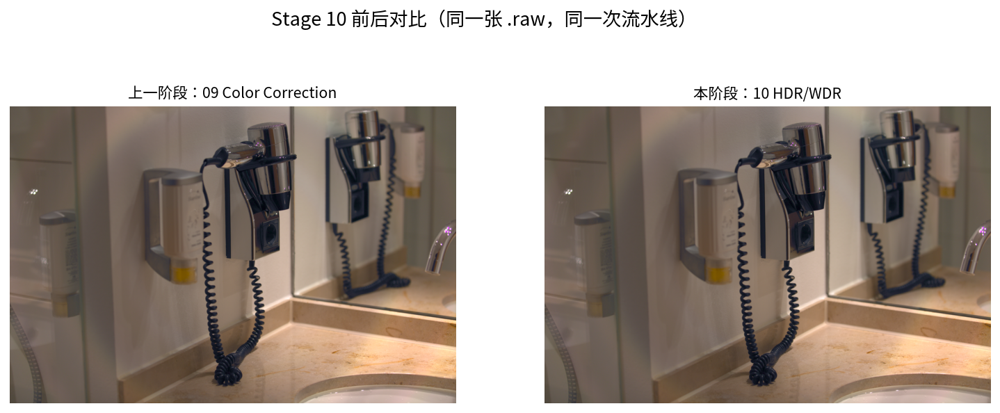
*10 HDR/WDR：高光软压缩。*

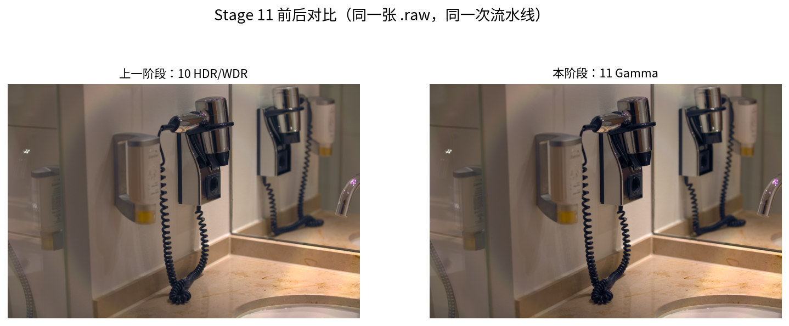
*11 Gamma：自动曝光 + sRGB。*

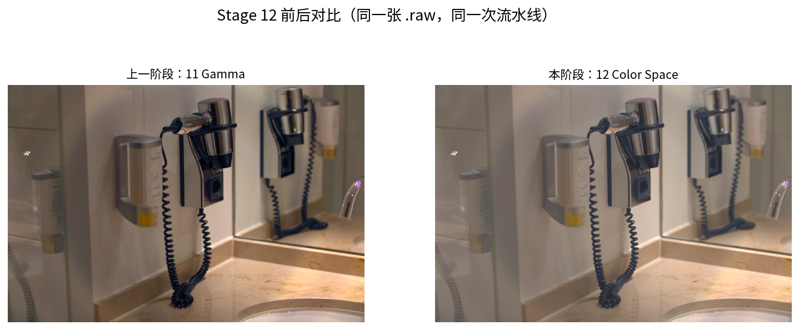
*12 Color Space：RGB → YUV。*

</details>

<details>
<summary><b>YUV 域：13 → 19</b></summary>


*13 NR Luma：只降 Y。*

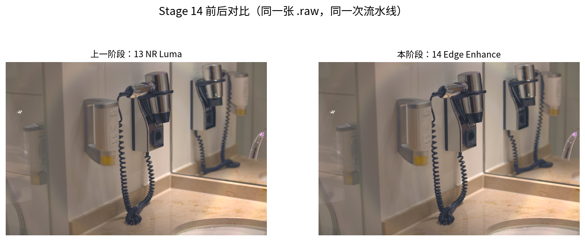
*14 Edge Enhance：只锐化 Y。*


*15 Contrast/Brightness：只改 Y。*


*16 NR Chroma：U/V 中值。*


*17 Hue/Saturation：色度旋转。*

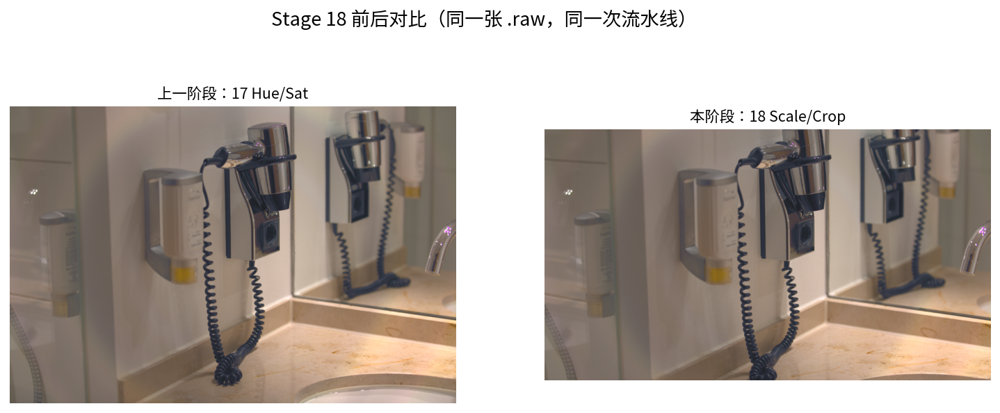
*18 Scale/Crop：1/2 + 16:9。*

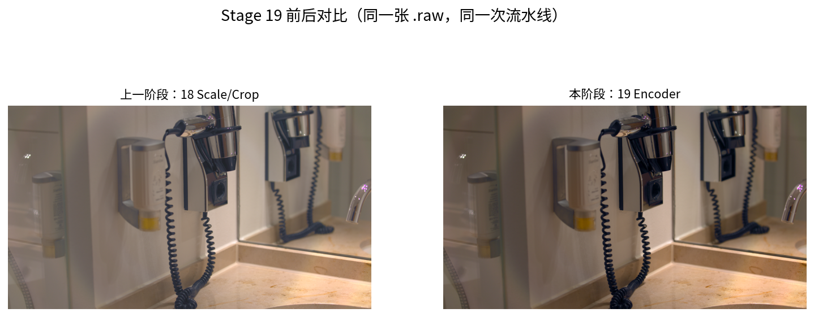
*19 Encoder：YUV → PNG。*

</details>

> 旁路：`./build/isp_ae_af data/sample.raw` 会打印 AE 亮度分位数和 AF 绿色梯度。
> 它们是不进图像链路的控制闭环。

---

## 4. 三个域，各自在修什么

### 4.1 RAW 域：先修数据

**输入**：单通道 Bayer，线性，带黑电平/暗角/坏点/噪声。
**输出**：三通道线性 RGB。

关键顺序：

```text
BLC → LSC → BPC/DPC → NR RAW → AWB → Demosaic
```

为什么？

- **先减黑电平，再乘增益**：黑电平是加性偏置，白平衡是乘性增益；
  先乘会把偏置放大成偏色。
- **坏点/噪声在 RAW 域修**：此时一个坏点只是一个像素；
  去了马赛克，它会扩散成 3×3 的彩色斑块。
- **白平衡在去马赛克前**：Bayer 上每个像素只有一种颜色，乘增益是线性的；
  先做不会引入插值误差。

### 4.2 RGB 域：把颜色算对

**输入**：线性相机 RGB。
**输出**：编码后的 sRGB / 显示 RGB。

```text
NR Color → X-talking → Color Correction → HDR/WDR → Gamma → Color Space
```

- **NR Color**：去马赛克把噪声变成彩色斑块，先在 YUV 里压色度；
- **X-talking**：滤光片不是理想窄带，R/G/B 会互相漏，用 3×3 矩阵校正；
- **Color Correction**：相机 RGB → XYZ → linear sRGB；
- **HDR/WDR**：只压 >1 的高光，避免硬 clip 的品红；
- **Gamma**：线性光不能直接写 8bit，做自动曝光 + sRGB；
- **Color Space**：进入 YUV，给后面的显示/编码用。


### 4.3 YUV 域：修观感，再编码

**输入**：YUV(BT.709)。
**输出**：PNG / YUV420。

```text
NR Luma → Edge Enhance → Contrast/Brightness
→ NR Chroma → Hue/Saturation → Scale & Crop → Encoder
```

- 人眼对**亮度细节**敏感、对**色度分辨率**不敏感；
- 所以 Y 做小半径双边 + 适度锐化，U/V 可以做更强的中值降噪；
- 对比度/色相只在 YUV 里做，避免反复转 RGB；
- 缩放放在最后，避免中间阶段反复重采样。


---

## 5. 工程结构

```text
ISP_Raw_Course/
├── build.sh                  # cmake + make
├── run_pipeline.sh           # 一键 / --keep / --steps
├── CMakeLists.txt
├── common/
│   ├── include/isp/
│   │   ├── image.h           # Image + .isp 容器
│   │   ├── raw.h             # .raw + .meta
│   │   ├── stages.h          # 20 个阶段声明
│   │   ├── color.h           # sRGB / 矩阵
│   │   ├── io.h / preview.h / cli.h
│   └── src/
├── stages/
│   ├── 00_raw_load/
│   │   ├── README.md
│   │   ├── stage.cpp
│   │   └── main.cpp
│   └── ... 19_encoder/
├── apps/
│   ├── isp_pipeline.cpp      # 内存流水线
│   ├── isp_dump.cpp          # .isp -> PNG
│   ├── isp_info.cpp          # 看头
│   └── isp_ae_af.cpp         # AE/AF 旁路统计
├── data/
│   ├── sample.raw
│   ├── sample.meta
│   └── README.md
├── docs/                     # 手册、原理、PPT、视频、插图
└── out/                      # final.png / stage/*.isp
```

### 5.1 一个 stage 长什么样

```cpp
// stages/01_blc/stage.cpp
void stage01_blc(Image& img, bool clip) {
    img.require_f32();
    float* p = img.pix_f32();
    for (int y = 0; y < h; ++y)
        for (int x = 0; x < w; ++x) {
            const int pos = img.cfa_pos(x, y);
            float v = (p[i] - img.black[pos]) /
                      (img.white - img.black[pos]);
            p[i] = clip ? clamp01(v) : v;
        }
    img.black = {0,0,0,0};
    img.white = 1;
}
```

- 输入/输出都是 `Image`；
- 每个 stage 只做一件事；
- 中间结果用 `.isp` 落盘，随时能看；
- `main.cpp` 只是薄薄一层 CLI。

### 5.2 `.isp` 中间格式

```text
284 字节头 + 纯像素数据（小端）
头里有：宽高、通道、CFA、dtype、bit depth、色彩空间、
        black/white、wb、cam_to_xyz、camera、note
```

`isp_info` 只读头，不读几十 MB 像素；`isp_dump` 负责转 PNG。

---

## 6. 运行方式

### 6.1 内存流水线

```bash
./build/isp_pipeline \
  --raw data/sample.raw --meta data/sample.meta \
  --out out/final.png --keep
```

每个阶段打印耗时和统计；`--keep` 写 `out/stage/XX_name.isp`。

### 6.2 分步跑

```bash
./run_pipeline.sh --steps
```

20 个进程依次执行，输出 `out/steps/*.isp` 和 `out/final_steps.png`。
本工程已验证：**分步与内存输出的逐像素最大差异为 0**。

### 6.3 常用参数

```bash
--method bilinear     # 去马赛克对比
--no-gray-world       # 只用 meta 的 AWB
--awb-strength 0.5    # 灰度世界混合比例
--wdr 0.4             # 高光压缩
--manual --ev 0.5     # 手动曝光
--no-crop             # 不裁 16:9
--yuv                 # 额外输出 YUV420
```

完整参数：[`docs/USAGE.md`](docs/USAGE.md)。

---

## 7. 结果与验证

| 项目 | 结果 |
|------|------|
| 输入 | 5760×3840，16bit Bayer，44 MB |
| 输出 | 2880×1620，8bit sRGB PNG |
| 全流程 | ~13 s（单线程） |
| 峰值内存 | ~580 MB |
| 阶段数 | 20 |
| 分步 vs 内存 | 最大差异 **0** |
| YUV 输出 | `--yuv` 写 4:2:0 planar |


---

## 8. 与旧版 DNG 工程的区别

| 项目 | 旧版 | 本工程 |
|------|------|--------|
| 输入 | 未压缩 DNG | **纯 `.raw` + `.meta`** |
| 阶段 | 11 | **20** |
| 组织 | 一条线性链 | **RAW / RGB / YUV 三域** |
| RAW 域 | BLC/LSC/DPC/NR/WB/Demosaic | 同左，命名对齐课程 |
| RGB 域 | CCM/Gamma/Sharpen | **NR Color / X-talking / CCM / HDR-WDR / Gamma / Color Space** |
| YUV 域 | 无 | **NR Luma / Edge / Contrast / NR Chroma / Hue-Sat / Scale-Crop / Encoder** |
| 输出 | 8bit PNG | **PNG + 可选 YUV420** |
| 文档 | 每 stage 一篇 | 每 stage 一篇 + 前后对比 + 三域总论 |

流程顺序以 B 站课程
[《【图像ISP基础】从黑白电平RAW到彩色照片，数字成像的魔法》](https://www.bilibili.com/video/BV1cbu16WEei/)
（UP：养蝶的庭师）的“技术总览”图为准：

```text
BLC → LSC → BPC/DPC → NR RAW → AWB → Demosaic
→ NR Color → X-talking → Color Correction → HDR/WDR
→ Gamma → Color Space → NR Luma → Edge Enhance
→ Contrast/Brightness → NR Chroma → Hue/Saturation
→ Scale & Crop → Encoder
```

---

## 9. 文档 / PPT / 视频

- [使用手册](docs/USAGE.md)：参数、每个 stage 的命令、`.raw/.meta` 格式、排错；
- [原理总论](docs/PRINCIPLES.md)：三域流程、每个模块的公式与取舍；
- 每节的详细讲义：见上面的阶段总表；
- [10 页 PPTX](docs/ISP_Raw_5min.pptx) / [PDF](docs/ISP_Raw_5min.pdf)；
- **通用 ISP 科普动画（新）**：[ISP_Overview_Animated.mp4](docs/ISP_Overview_Animated.mp4)：
  1920×1080，24fps，**6:46**，讲 ISP 是什么、三个域、每个模块在做什么；
  不介绍本工程，示例是蓝天/草地/树木的风景 RAW；
- **RAW 工程动画**：[ISP_Raw_Animated_5min.mp4](docs/ISP_Raw_Animated_5min.mp4)：
  5:01，用真实风景 RAW 的实际 stage 图演示；
- **PPT 版视频（保留）**：[ISP_Raw_5min.mp4](docs/ISP_Raw_5min.mp4)：
  1080p，5:27，按 PPT 讲；
- [通用科普讲解词](docs/ISP_Overview_讲解词.md) / [工程动画讲解词](docs/ANIM_讲解词.md) / [PPT 版讲解词](docs/PPT_讲解词.md)；
- [通用科普制作说明](docs/VIDEO_OVERVIEW_README.md) / [工程动画制作说明](docs/VIDEO_ANIMATED_README.md)；
- [通用科普封面](docs/images/isp_overview_poster.jpg) / [工程动画封面](docs/images/animated_poster.jpg) / [PPT 版封面](docs/images/video_poster.jpg)。

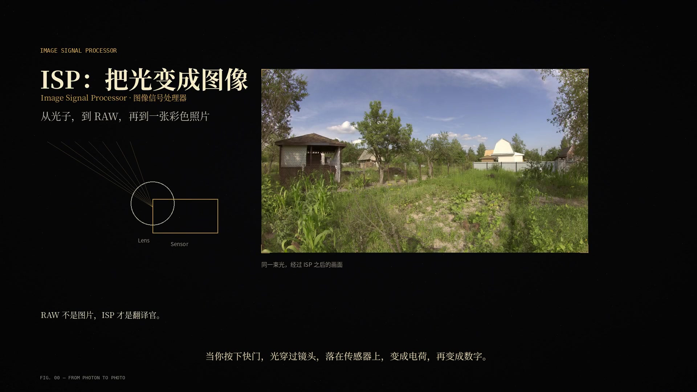

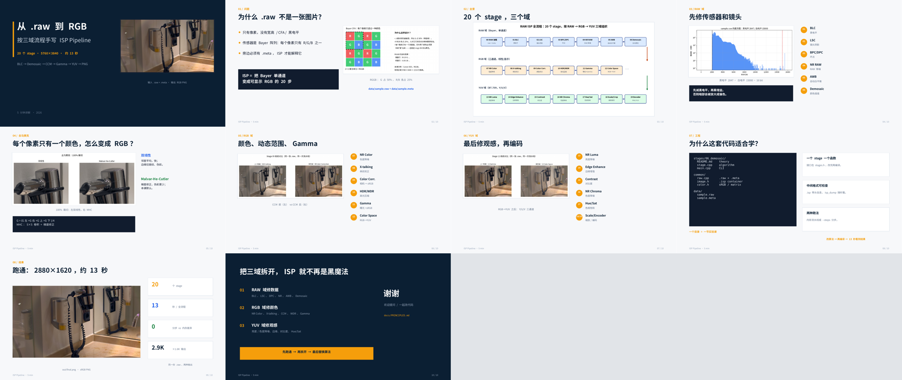

---

## 10. 边界：这不是量产 ISP

本工程刻意保留“能看懂”的最小实现：

1. **LSC** 用图像自身统计近似，没有 flat-field 标定；
2. **AWB** 是灰度世界 + 相机参考，不是完整 3A 闭环；
3. **X-talking / CCM** 用简化 3×3，没有按色温插值；
4. **HDR/WDR** 只做高光软压缩，没有多帧合成；
5. **AE/AF** 只提供旁路统计，不驱动曝光/马达；
6. 没有镜头畸变、色差、多帧降噪、SIMD/GPU、tile 处理；
7. 没有压缩 RAW（LibRaw/rawspeed）解析。

这些不是“忘记做”，而是 5 分钟能讲完、13 秒能跑完的边界。
原理文档最后一章列了从教学到产品还缺什么。

---

## 11. 参考

- B 站课程：[【图像ISP基础】从黑白电平RAW到彩色照片，数字成像的魔法](https://www.bilibili.com/video/BV1cbu16WEei/)，UP：养蝶的庭师；
- 示例 RAW 来源：[raw.pixls.us](https://raw.pixls.us/)，Canon 5D3，CC0；
- 颜色：Bruce Lindbloom 的 XYZ/sRGB 矩阵，sRGB IEC 61966-2-1；
- 去马赛克：Malvar, He, Cutler, *High-Quality Linear Interpolation for Demosaicing of Bayer-Patterned Color Images*, ICASSP 2004。
