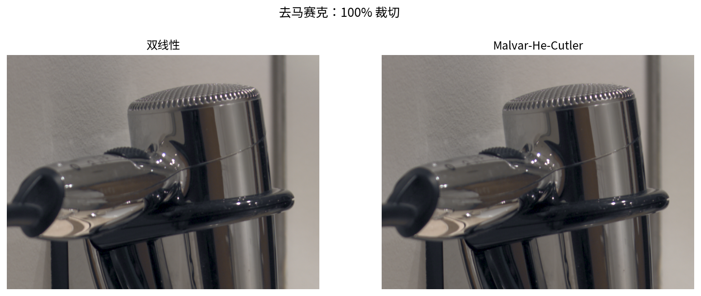

# ISP 原理总论：RAW 域 → RGB 域 → YUV 域


本文按 B 站课程《【图像ISP基础】从黑白电平RAW到彩色照片，数字成像的魔法》
的三域流程组织：

```text
RAW 域：BLC → LSC → BPC/DPC → NR RAW → AWB → Demosaic
RGB 域：NR Color → X-talking → Color Correction → HDR/WDR → Gamma → Color Space
YUV 域：NR Luma → Edge Enhance → Contrast/Brightness → NR Chroma
        → Hue/Saturation → Scale & Crop → Encoder
```

---

## 1. 从传感器到 .raw

传感器每个像素只记录 R/G/B 中的一种，输出的是 Bayer 单通道数据。
本工程把它存成**无文件头、16bit little-endian** 的 `.raw`：

```text
sample.raw = width*height 个 uint16，按行优先排列
```

纯 `.raw` 没有宽高/CFA/黑电平，所以旁边必须有 `.meta`：

```text
width 5760
height 3840
bayer RGGB
black 2047 2047 2047 2048
white 15000
wb 1.649 1.000 2.165
cam_to_xyz ...
```

工业上这些信息在传感器寄存器、驱动或 DNG/EXIF 里；教学工程显式写出来，
方便你手改参数做实验。


---

## 2. 为什么分三个域

| 域 | 数据 | 主要任务 |
|---|---|---|
| RAW 域 | 单通道 Bayer，线性 | 修传感器/镜头的缺陷，白平衡 |
| RGB 域 | 三通道，线性/显示 | 颜色正确、动态范围、Gamma |
| YUV 域 | Y/U/V，BT.709 | 人眼友好的降噪、增强、缩放、编码 |

核心原则：

1. **线性运算尽量在 Gamma 之前**：黑电平、增益、CCM 都是线性操作；
2. **RAW 域修“点/像素”问题**：坏点、噪声在 RAW 域只是一个点，去马赛克后会扩散；
3. **YUV 域利用人眼特性**：Y 保留细节，U/V 可以更激进地降噪/压缩。

---

## 3. RAW 域

### 3.1 BLC（黑电平校正）

```text
v = (raw - black[cfa]) / (white - black[cfa])
```

不减黑电平，后面乘白平衡增益会把偏置放大成暗部偏色。

### 3.2 LSC（镜头阴影校正）

镜头 cos⁴ 衰减导致四角变暗。工业上用 flat-field 标定：

```text
gain(x,y) = mean(flat) / flat(x,y)
```

本工程用径向中位数估计 gain，是“没有标定数据”的近似，场景内容会污染估计。

### 3.3 BPC/DPC（坏点校正）

同色 4 邻域（上下左右各隔 2 像素）的中值；如果中心是孤立极值且差值超过阈值，
就用中值替换。不能修大片 cluster 缺陷。

### 3.4 NR RAW（RAW 域降噪）

双边滤波：

```text
w = exp(-|p-q|²/2σs²) · exp(-(I(p)-I(q))²/2σr²)
```

只对同色邻居采样（`dx+dy` 为偶数），避免把 R/G/B 混在一起。

### 3.5 AWB（自动白平衡）

中性物体应满足 R=G=B。DNG/相机给的是 AsShotNeutral，本工程用灰度世界：

```text
gain_c = mean_G / mean_c
```

再和 meta 里的参考增益混合，避免单色场景把颜色拉灰。

### 3.6 Demosaic（去马赛克）

Bayer 上每个像素只有一个颜色，另外两个靠邻居插值。
双线性是邻居平均；Malvar-He-Cutler 用 5×5 卷积 + 梯度修正，本工程默认 MHC。



---

## 4. RGB 域

### 4.1 NR Color（色度降噪）

转 YUV，对 Cb/Cr 做 3×3 中值，Y 保持。这样不会把亮度细节糊掉。

### 4.2 X-talking（颜色串扰）

滤光片不是理想窄带，R/G/B 会互相漏。用 3×3 矩阵校正：

```text
R' = R - kG - kB
G' = -kR + G - kB
B' = -kR - kG + B
```

再按行归一化，保证白点不变。`k` 越大，颜色越“分离”，但也越容易过饱和。

### 4.3 Color Correction（CCM）

相机 RGB 不是 sRGB。先到 XYZ，再到 sRGB：

```text
M = XYZ_to_sRGB · cam_to_xyz
```

每行归一化，保证 `(1,1,1)` 仍是 `(1,1,1)`。负系数会放大噪声/伪彩。

### 4.4 HDR/WDR（高光压缩）

只压缩 >1 的高光，0..1 不动：

```text
v' = 1 + (v-1)/(1 + k(v-1))
```

避免硬 clip 造成品红高光。

### 4.5 Gamma

自动曝光（99.5% 分位）+ sRGB 传输函数：

```text
v ≤ 0.0031308 : 12.92v
否则          : 1.055 v^(1/2.4) - 0.055
```

### 4.6 Color Space（RGB → YUV）

BT.709 full range：

```text
Y = 0.2126R + 0.7152G + 0.0722B
U = (B - Y) / 1.8556
V = (R - Y) / 1.5748
```

之后数据就进入 YUV 域，U/V 是带符号的 [-0.5, 0.5]。

---

## 5. YUV 域

### 5.1 NR Luma

只对 Y 做 3×3 双边，U/V 不动。人眼对亮度噪声最敏感，但亮度也承载细节，
所以 σ 要小。

### 5.2 Edge Enhance

Y 的 unsharp mask：

```text
Y' = Y + amount · (Y - blur(Y))
```

只改 Y，避免彩色描边。

### 5.3 Contrast/Brightness

```text
Y' = (Y - 0.5)·contrast + 0.5 + brightness
```

### 5.4 NR Chroma

U/V 的 3×3 中值。人眼对色度空间分辨率低，可以比亮度更激进。

### 5.5 Hue/Saturation

旋转 (U,V) 并缩放饱和度：

```text
u' = (u cosθ - v sinθ)·sat
v' = (u sinθ + v cosθ)·sat
```

### 5.6 Scale & Crop

2×2/4×4 box 缩放；可中心裁成 16:9。缩放放在最后，避免中间阶段反复重采样。

### 5.7 Encoder

YUV→RGB：

```text
R = Y + 1.5748V
G = Y - 0.1873U - 0.4681V
B = Y + 1.8556U
```

写 PNG；可选写 YUV420 planar（Y 全分辨率，U/V 2×2 下采样）。

---

## 6. AE/AF 为什么不在主链路

课程框图里还有 **AE 测光** 和 **AF 对焦** 两个菱形。它们不是图像处理节点，
而是**控制闭环**：

- AE：统计亮度直方图 → 调曝光/增益；
- AF：统计对比度/相位 → 调镜头马达。

本工程在 `isp_pipeline` 里用“自动曝光分位数”模拟 AE 的最终结果；
另提供 `isp_ae_af` 旁路工具，统计 RAW 的亮度分位数和绿色梯度，
分别对应 AE 的测光和 AF 的清晰度评价。它不驱动曝光/马达——真实 3A 是闭环。

---

## 7. 怎么判断调得好不好

| 方法 | 看什么 |
|---|---|
| RAW 直方图 | 黑电平/白电平、有没有大面积死黑 |
| 100% 裁切 | 去马赛克伪彩、降噪、锐化白边 |
| 中性色 | 白墙是否 R=G=B |
| YUV 波形/直方图 | Y 是否过曝、U/V 是否溢出 |
| 最终图 | 肤色、金属高光、暗部噪声 |

---

## 8. 从教学到产品

本工程省略/简化了：

1. 3A 闭环（AE/AF/AWB 的反馈控制）；
2. 镜头畸变、色差、真正的 flat-field LSC；
3. 更好的去马赛克（方向自适应/频率域）；
4. 多帧降噪、HDR 合成；
5. 色彩管理（ICC、广色域）；
6. SIMD/GPU、tile 处理、零拷贝；
7. 压缩 RAW 解析（LibRaw/rawspeed）。

---

## 9. 术语表

| 术语 | 含义 |
|---|---|
| RAW | 传感器原始 Bayer 数据 |
| BLC | Black Level Correction，黑电平校正 |
| LSC | Lens Shading Correction，镜头阴影校正 |
| BPC/DPC | Bad/Defect Pixel Correction，坏点校正 |
| NR | Noise Reduction，降噪 |
| AWB | Auto White Balance，自动白平衡 |
| CCM | Color Correction Matrix，颜色校正矩阵 |
| WDR | Wide Dynamic Range，宽动态 |
| YUV | 亮度+色度颜色空间，BT.709 |
| Cb/Cr | 数字 YUV 的色度分量（本工程写作 U/V） |
