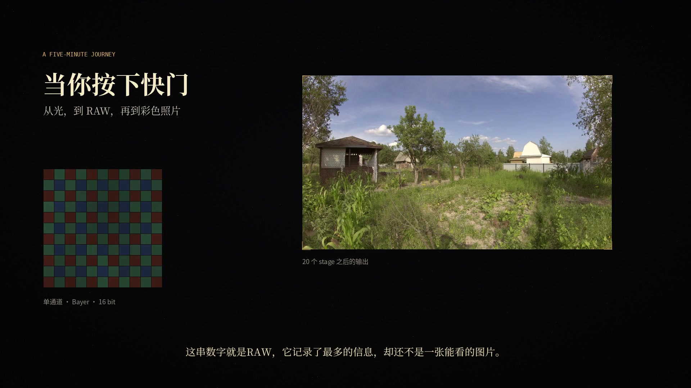

# 动画版讲解视频（不依赖 PPT）

> 成片：[`ISP_Raw_Animated_5min.mp4`](ISP_Raw_Animated_5min.mp4)  
> 字幕：[`subtitles/ISP_Raw_Animated_5min.srt`](subtitles/ISP_Raw_Animated_5min.srt) ·
> [`ISP_Raw_Animated_5min.ass`](ISP_Raw_Animated_5min.ass)  
> 封面：[`images/animated_poster.jpg`](images/animated_poster.jpg)



## 它是什么

这是 RAW 工程的**动画版**讲解，不读 PPT，也不需要 `docs/ISP_Raw_5min.pdf`。
画面由 `tools/make_landscape_anim.py` 用 PIL/numpy 逐帧绘制：

- 深色底 + 米金配色 + 细线，参考 3Blue1Brown 风格的科普动画；
- 实际 RAW、Bayer 马赛克、真实直方图、LSC 暗角、坏点邻域、降噪前后、
  AWB 增益、去马赛克 100% 裁切、CCM 矩阵、Gamma 曲线、Y/U/V 通道；
- 每一段都跟着配音走，不是“PPT 加转场”。

示例是 **Canon EOS D60 的风景 RAW**（蓝天/草地/树木），
用 rawpy 从 CRW 的 `raw_image_visible` 导出真实 Bayer 数据。
原来的 PPT 版视频仍然保留：[`ISP_Raw_5min.mp4`](ISP_Raw_5min.mp4)（5:27）；
旧的水龙头版本备份为 [`ISP_Raw_Animated_5min_faucet.mp4`](ISP_Raw_Animated_5min_faucet.mp4)。

## 规格

| 项目 | 值 |
|---|---|
| 时长 | **5:00.71** |
| 画面 | 1920×1080，24fps，H.264 High |
| 声音 | AAC 48kHz 立体声；Xiaoyi，`+4%` / `+2Hz` |
| 字幕 | 米色衬线 + 深色描边，烧录；另附 SRT |
| 音乐 | numpy 生成的 Am–F–C–G 氛围铺底，压在人声之下 |
| 体积 | 约 26 MB |
| 开场 | 前 **1 秒**只停讲解，音乐和动画继续 |

## 分镜

| # | 场景 | 内容 |
|---|------|------|
| 1 | 当你按下快门 | 标题、Bayer 网格、最终成片；前 1 秒只停讲解 |
| 2 | RAW 不是图片 | 字节、meta、RGGB 排列 |
| 3 | 三个域，二十步 | 20 个节点逐一点亮 |
| 4 | RAW 域：先修数据 | BLC 直方图、LSC 暗角、DPC 邻域、NR 前后、AWB 增益、Demosaic |
| 5 | 去马赛克：猜颜色 | 马赛克→RGB、双线性 vs MHC 100% 裁切 |
| 6 | RGB 域：把颜色算对 | CCM 前后、HDR 前后、Gamma 曲线、Y/U/V |
| 7 | YUV 域：修观感 | Y 通道、Y 降噪/锐化、U/V、色相轮 |
| 8 | 跑通：3 秒 | 前后滑块、1544×868、0 diff |
| 9 | 三句话 | RAW/RGB/YUV 总结 |

逐句讲稿：[`ANIM_讲解词.md`](ANIM_讲解词.md)。

## 重新生成

```bash
cd /home/lchin/ISP_Raw_Course

# 1. 改稿：tools/anim_script_landscape.py
# 2. 重新配音
PYTHONPATH=.pylibs python3 tools/landscape_anim_tts.py

# 3. 精确句子边界
PYTHONPATH=.pylibs python3 tools/landscape_anim_bounds.py

# 4. 重新渲染 + 混音 + 烧字幕
python3 tools/make_landscape_anim.py
```

依赖：

- `.pylibs/`：`edge-tts`、`imageio-ffmpeg`；
- 系统 Python：`numpy`、`Pillow`；
- 字体：`Noto Serif CJK SC` / `Noto Sans CJK SC`；
- 不需要 LibreOffice。

## 备注

- 背景音乐是本地合成的，不涉及版权；
- 配音仍是 `zh-CN-XiaoyiNeural`，只把语速/音高稍微提亮，听起来更活泼；
- 动画版和 PPT 版共用同一份工程数据，但讲稿是两份，互不覆盖。
