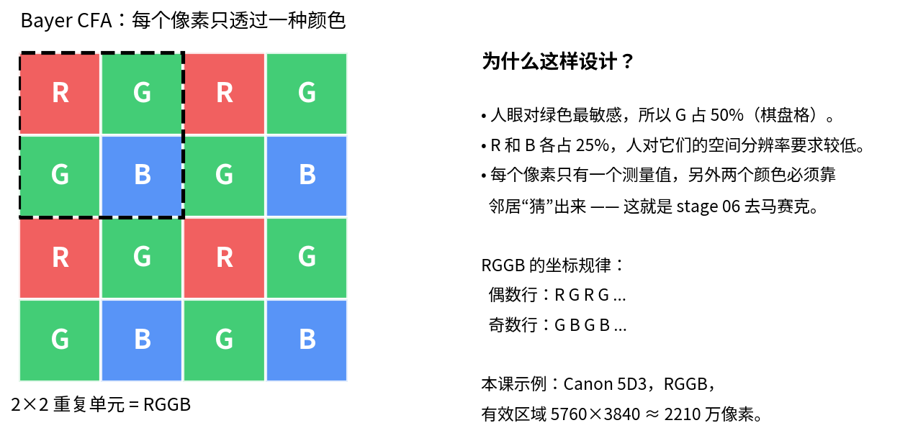

# Stage 00 · RAW 加载：.raw + .meta → Bayer

> **一句话**：把无文件头的 16bit RAW 和一份 meta 读成单通道 Bayer。

## 前后对比


*stage 00 读进来的单通道 Bayer；下面补充它的 2×2 排列。*



*RGGB：G 占 50%，R/B 各 25%。*


---

## 本节目标

- 理解纯 .raw 为什么必须配 meta
- 知道 Bayer 2×2 的四个位置
- 会检查文件大小和字节序

## 输入 / 输出

| | |
|---|---|
| 输入 | `data/sample.raw` + `data/sample.meta` |
| 输出 | 单通道 `Image`，`dtype=U16`，`cfa=RGGB` |
| 目录 | `stages/00_raw_load/` |

## 原理

纯 `.raw` 只有像素，没有宽高、CFA、黑电平。ISP 必须先从 `.meta` 知道“这张图多大、什么 Bayer 排列、黑白电平是多少、白平衡和颜色矩阵是什么”。

本工程把 meta 做成一行的文本，而不是二进制头。这样你可以用记事本改一个 black 值，重新跑 stage 01，立刻看到直方图变化，不需要重新编译。

### 公式

```text
文件大小 = width × height × 2（16bit little-endian）
Bayer 2×2：
R G
G B   （RGGB）
```

## 代码走读

文件：[`stages/00_raw_load/stage.cpp`](stage.cpp)

1. `load_raw_meta()` 逐行解析 key/value；`#` 开头是注释。
2. `load_raw()` 检查文件大小必须正好等于 `w*h*2`，否则直接报错。
3. CFA 字符串映射到 `CFA_RGGB/BGGR/GRBG/GBRG`，后面所有 `cfa_color()` 都依赖它。

## 跑一跑

```bash
./build/isp_00_raw_load data/sample.raw out/00_raw_load.isp --meta data/sample.meta
./build/isp_info out/00_raw_load.isp
```

## 观察与实验

- `xxd -l 32 data/sample.raw`：前两个 16bit 就是左上角 R/G。
- 把 meta 的 `bayer` 改成 `BGGR`，跑 stage 06，看颜色是否错位。
- 把 `width` 改错 1，确认程序会报“文件大小不对”。

## 常见坑

- 把 `.raw` 当成有文件头的格式，直接读像素会整体偏移。
- 忽略字节序：大端机器读小端数据会得到荒谬的数值。
- meta 的 black/white 写错，后面所有阶段都会跟着错。

## 为什么放在这个位置

没有这一步，后面的坐标、CFA、黑白电平全是猜的。纯 `.raw` 不像 PNG 自带文件头，meta 就是它的“身份证”。

## 自检

- 把 width 改错 1，程序会报什么？
- 为什么 meta 不直接塞进 .raw 头部？
- RGGB 和 BGGR 的差别会在哪一步暴露？

---

**上一节** → 无  
**下一节** → [Stage 01 · BLC](../01_blc/README.md)
