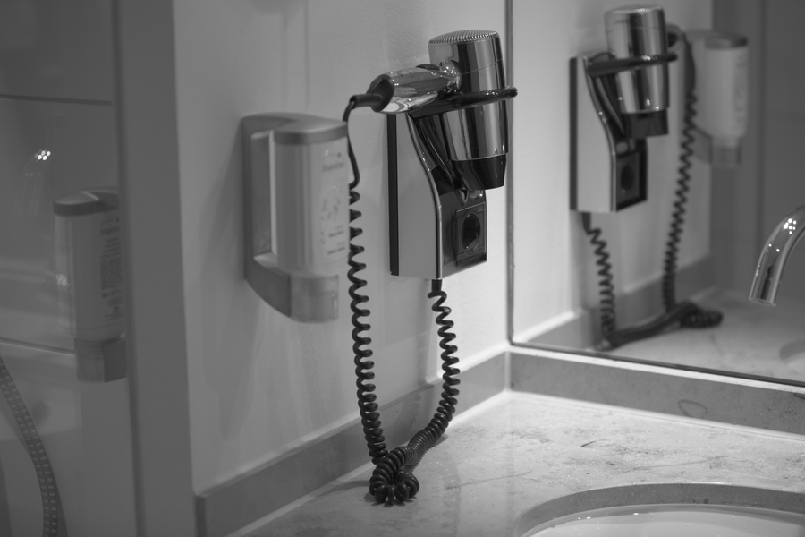

# Stage 01 · BLC 黑电平校正

> 传感器没光时读出来约 2047，不是 0。



## 这一节在做什么

- 公式：v = (raw - black[cfa]) / (white - black[cfa])。
- 四个 CFA 位置分别减，避免 B 增益放大成偏色。
- 先转 f32 再减，防止 uint16 下溢。

## 跑一跑

```bash
./build/isp_01_blc out/00_raw_load.isp out/01_blc.isp
```

## 实验

加 --noclip 看负值；把四个 black 改成同一个值看暗部偏色。

---

**上一节** → [Stage 00](../00_raw_load/README.md)  
**下一节** → [Stage 02](../02_lsc/README.md)
