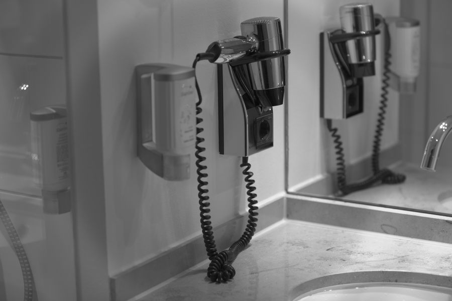

# Stage 02 · LSC 镜头阴影校正

> cos⁴ 暗角，用径向增益把四角提亮。



## 这一节在做什么

- 按半径分桶，每个 CFA 通道取亮度中位数。
- gain(r) = profile(0) / profile(r)，再平滑、限幅。
- 真实产品用 flat-field；本工程是场景统计近似。

## 跑一跑

```bash
./build/isp_02_lsc out/01_blc.isp out/02_lsc.isp --strength 0.7
```

## 实验

强度 0/0.5/1 对比四角；换平坦场景看估计是否更准。

---

**上一节** → [Stage 01](../01_blc/README.md)  
**下一节** → [Stage 03](../03_dpc/README.md)
