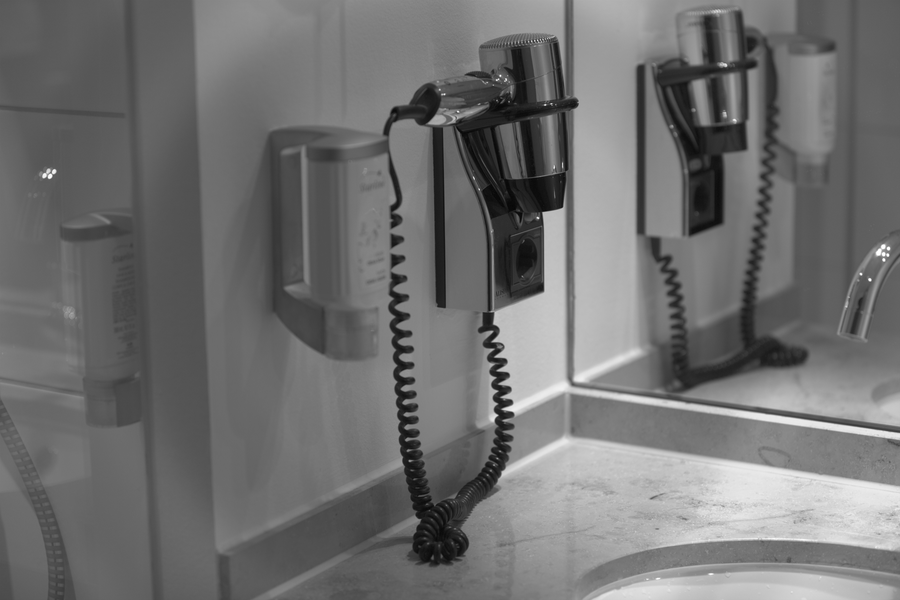

# Stage 03 · BPC/DPC 坏点校正

> hot/dead pixel 是孤立极值，用同色 4 邻域中值替换。



## 这一节在做什么

- 同色邻居在上下左右各隔 2 像素。
- 判据：中心是 5 个数的极值，且 |v-med| > threshold。
- 不能修大片 cluster 缺陷。

## 跑一跑

```bash
./build/isp_03_dpc out/02_lsc.isp out/03_dpc.isp --threshold 0.05
```

## 实验

阈值 0.01/0.05/0.2 对比；自己注入 0/65535 看修复。

---

**上一节** → [Stage 02](../02_lsc/README.md)  
**下一节** → [Stage 04](../04_nr_raw/README.md)
