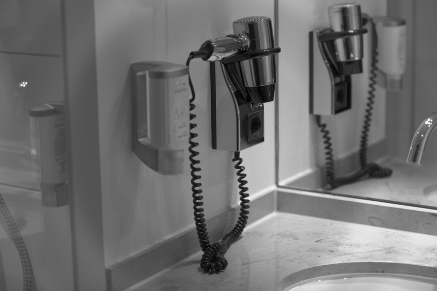

# Stage 04 · NR RAW 降噪

> 在 Bayer 上做双边，只采样同色邻居。



## 这一节在做什么

- w = exp(-dxy²/2σs²)·exp(-(I(p)-I(q))²/2σr²)。
- 同色条件：dx+dy 为偶数。
- RAW 域先降噪，避免去马赛克把噪声变成彩色斑块。

## 跑一跑

```bash
./build/isp_04_nr_raw out/03_dpc.isp out/04_nr_raw.isp
```

## 实验

--sigma 0 自动；手动 0.02 对比噪声/细节。

---

**上一节** → [Stage 03](../03_dpc/README.md)  
**下一节** → [Stage 05](../05_awb/README.md)
