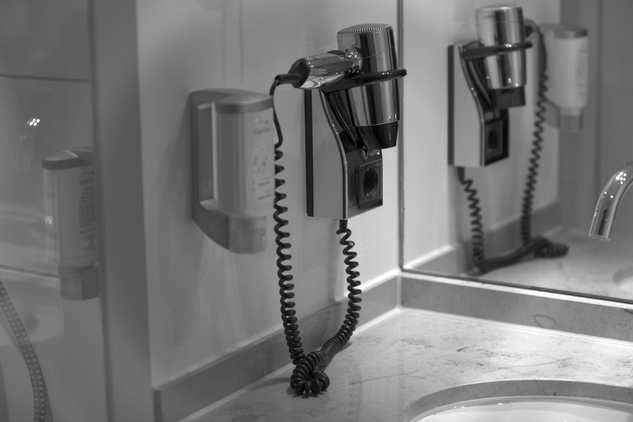

# Stage 05 · AWB 自动白平衡

> 中性物体应该 R=G=B。



## 这一节在做什么

- 灰度世界：gain_c = mean_G / mean_c。
- 单色场景会失败，所以和 meta 参考增益按 strength 混合。
- 统计时排除 >0.95 的高光。

## 跑一跑

```bash
./build/isp_05_awb out/04_nr_raw.isp out/05_awb.isp --strength 0.5
```

## 实验

对比 --no-gray-world；用大面积单色图解释灰度世界为什么失败。

---

**上一节** → [Stage 04](../04_nr_raw/README.md)  
**下一节** → [Stage 06](../06_demosaic/README.md)
