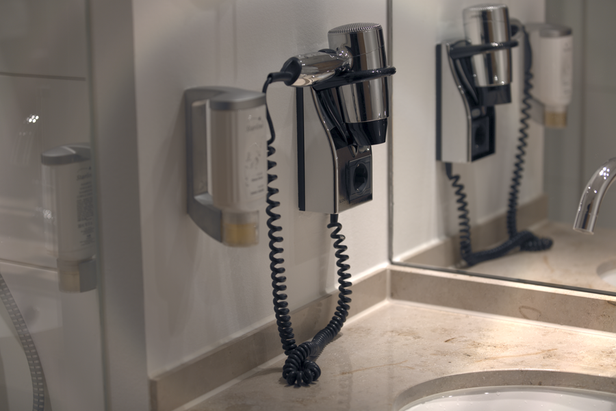

# Stage 06 · Demosaic 去马赛克

> 每个像素只有一个颜色，另外两个靠邻居插值。



## 这一节在做什么

- 双线性：G 取上下左右平均，R/B 取对角平均。
- MHC：5×5 卷积 + 已知通道梯度修正，伪彩更少。
- 输出变成 3 通道 RGB。

## 跑一跑

```bash
./build/isp_06_demosaic out/05_awb.isp out/06_demosaic.isp
```

## 实验

对比 --method bilinear；100% 裁切看拉链纹/伪彩。

---

**上一节** → [Stage 05](../05_awb/README.md)  
**下一节** → [Stage 07](../07_nr_color/README.md)
