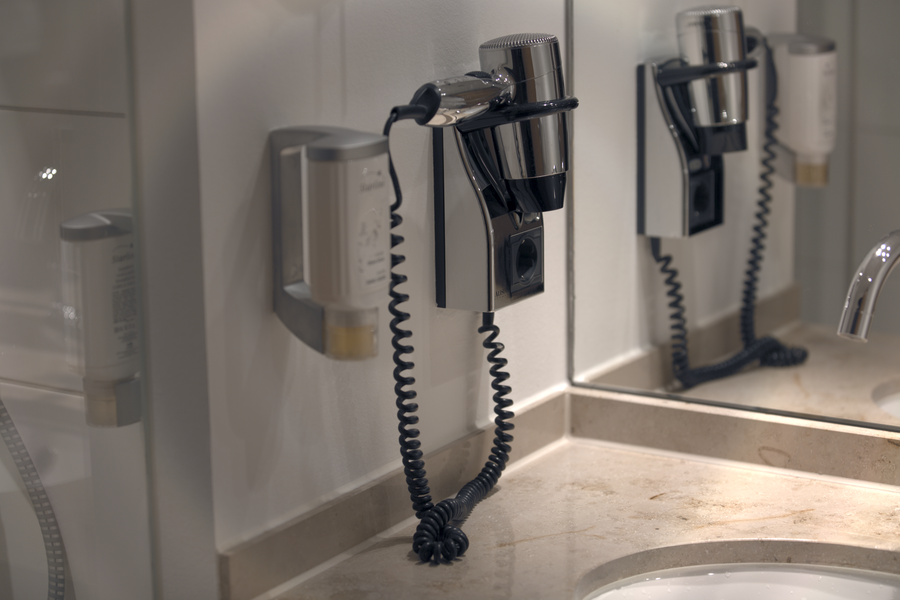

# Stage 07 · NR Color 色度降噪

> 转 YUV，只对 U/V 做中值，Y 保持。



## 这一节在做什么

- Y=0.2126R+0.7152G+0.0722B。
- U=(B-Y)/1.8556，V=(R-Y)/1.5748。
- 人眼对色度分辨率低，所以可以只降色度。

## 跑一跑

```bash
./build/isp_07_nr_color out/06_demosaic.isp out/07_nr_color.isp --strength 0.4
```

## 实验

强度 0/0.5/1 对比彩色噪点；观察颜色边缘是否渗色。

---

**上一节** → [Stage 06](../06_demosaic/README.md)  
**下一节** → [Stage 08](../08_xtalk/README.md)
