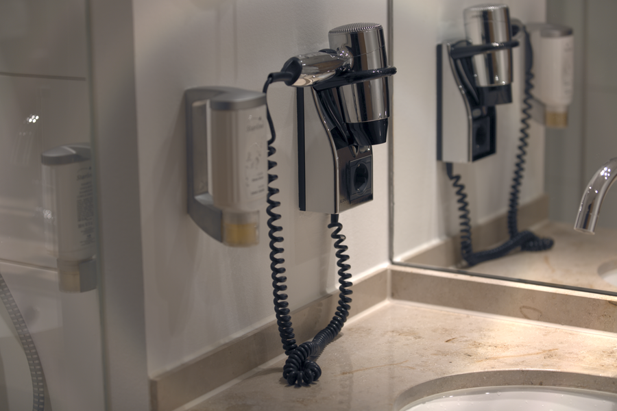

# Stage 08 · X-talking 串扰校正

> 滤光片不是理想窄带，R/G/B 会互相漏。



## 这一节在做什么

- R'=R-kG-kB，G'=-kR+G-kB，B'=-kR-kG+B。
- 按行归一化，保证白点不变。
- k 越大颜色越分离，也越容易过饱和。

## 跑一跑

```bash
./build/isp_08_xtalk out/07_nr_color.isp out/08_xtalk.isp --strength 0.04
```

## 实验

强度 0/0.05/0.1 对比肤色和金属高光。

---

**上一节** → [Stage 07](../07_nr_color/README.md)  
**下一节** → [Stage 09](../09_color_correction/README.md)
