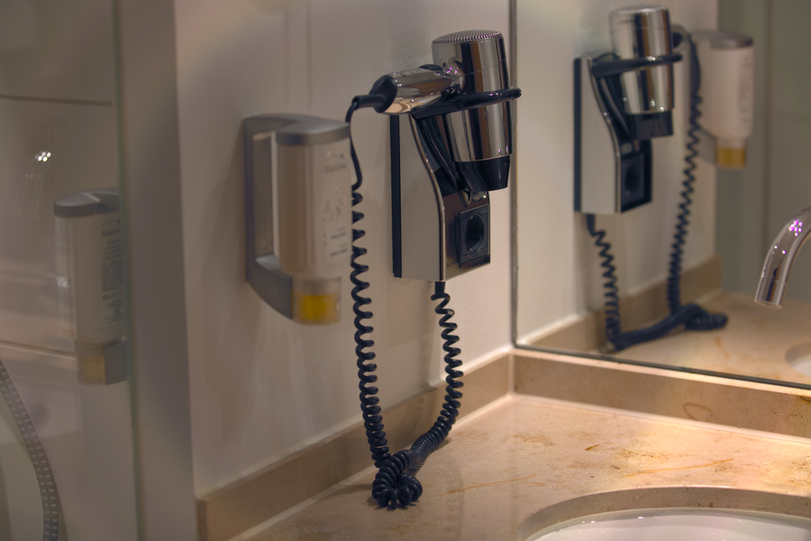

# Stage 09 · Color Correction 颜色校正

> 相机 RGB → XYZ → linear sRGB。



## 这一节在做什么

- M = XYZ_to_sRGB · cam_to_xyz。
- 每行归一化，保证 (1,1,1) 仍是 (1,1,1)。
- 负系数会放大噪声和伪彩。

## 跑一跑

```bash
./build/isp_09_color_correction out/08_xtalk.isp out/09_color_correction.isp
```

## 实验

把 cam_to_xyz 改成单位矩阵看颜色崩坏；去掉行归一化看偏色。

---

**上一节** → [Stage 08](../08_xtalk/README.md)  
**下一节** → [Stage 10](../10_hdr_wdr/README.md)
