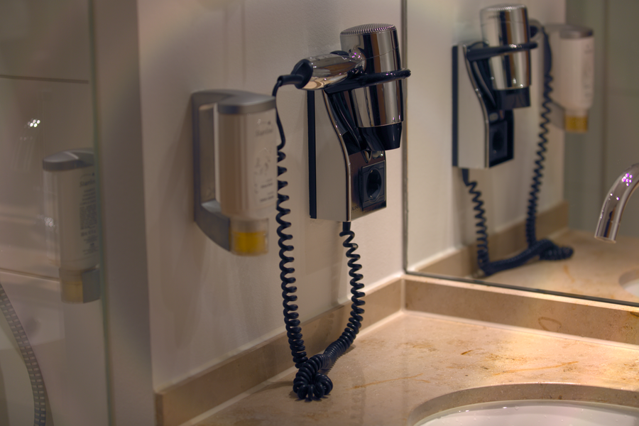

# Stage 11 · Gamma 自动曝光 + sRGB

> 线性光不能直接写 8bit。



## 这一节在做什么

- 用 99.5% 分位数自动曝光。
- sRGB：v<=0.0031308 时 12.92v，否则 1.055v^(1/2.4)-0.055。
- Gamma 必须在 CCM 之后。

## 跑一跑

```bash
./build/isp_11_gamma out/10_hdr_wdr.isp out/11_gamma.isp
```

## 实验

--manual --ev 0.5 对比；跳过 Gamma 直接看为什么又暗又脏。

---

**上一节** → [Stage 10](../10_hdr_wdr/README.md)  
**下一节** → [Stage 12](../12_color_space/README.md)
