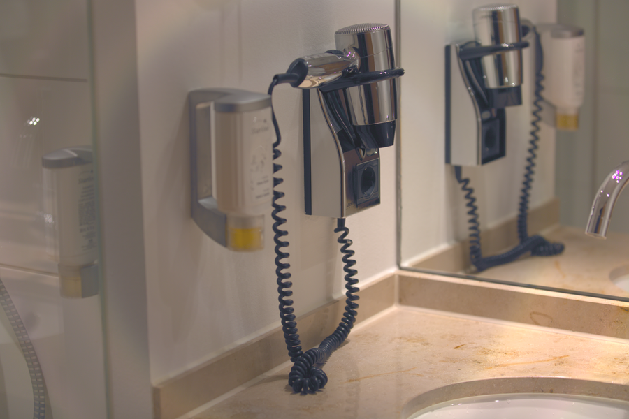

# Stage 12 · Color Space RGB→YUV

> 进入 YUV 域。



## 这一节在做什么

- Y=0.2126R+0.7152G+0.0722B。
- U=(B-Y)/1.8556，V=(R-Y)/1.5748。
- 输出 .isp 的 space 标记为 YUV。

## 跑一跑

```bash
./build/isp_12_color_space out/11_gamma.isp out/12_color_space.isp
```

## 实验

用 isp_info 看 space: YUV；把 U/V 清零得到灰度。

---

**上一节** → [Stage 11](../11_gamma/README.md)  
**下一节** → [Stage 13](../13_nr_luma/README.md)
