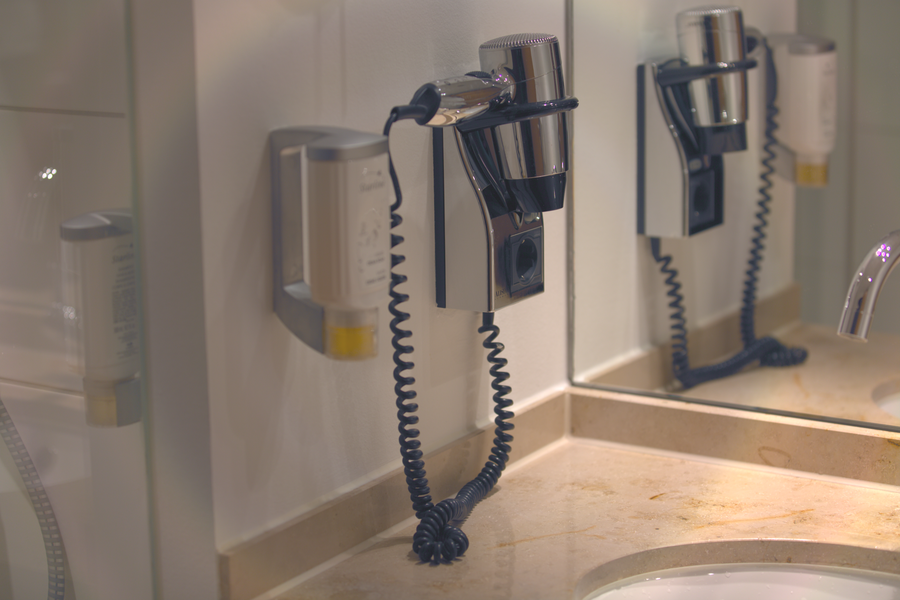

# Stage 13 · NR Luma 亮度降噪

> 只对 Y 做小半径双边。



## 这一节在做什么

- Y 同时承载亮度和细节，σ 要小。
- 默认 σ=0.012；太大画面会变塑料。
- U/V 完全不动。

## 跑一跑

```bash
./build/isp_13_nr_luma out/12_color_space.isp out/13_nr_luma.isp --sigma 0.012
```

## 实验

σ 0/0.02/0.05 对比暗部噪声和细节。

---

**上一节** → [Stage 12](../12_color_space/README.md)  
**下一节** → [Stage 14](../14_edge_enhance/README.md)
