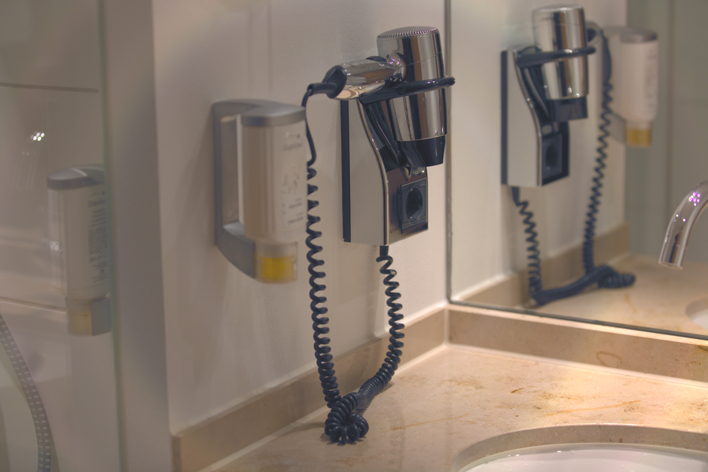

# Stage 14 · Edge Enhance 边缘增强

> 只增强 Y，避免彩色描边。



## 这一节在做什么

- Y' = Y + amount·(Y - blur(Y))。
- |detail| < 0.004 时不处理，避免放大噪声。
- 3×3 可分离高斯。

## 跑一跑

```bash
./build/isp_14_edge_enhance out/13_nr_luma.isp out/14_edge_enhance.isp --amount 0.4
```

## 实验

amount 0/0.5/1.5 对比白边和噪点。

---

**上一节** → [Stage 13](../13_nr_luma/README.md)  
**下一节** → [Stage 15](../15_contrast_brightness/README.md)
