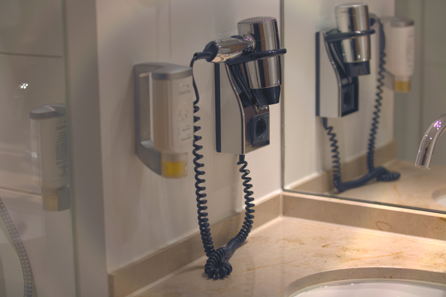

# Stage 15 · Contrast/Brightness 对比度

> 只改 Y。



## 这一节在做什么

- Y' = (Y-0.5)·contrast + 0.5 + brightness。
- 对比度太大暗部死黑、亮部死白。
- U/V 不动，色相不变。

## 跑一跑

```bash
./build/isp_15_contrast_brightness out/14_edge_enhance.isp out/15_contrast_brightness.isp --contrast 1.05
```

## 实验

对比度 0.8/1.0/1.3；亮度 ±0.05 看直方图。

---

**上一节** → [Stage 14](../14_edge_enhance/README.md)  
**下一节** → [Stage 16](../16_nr_chroma/README.md)
