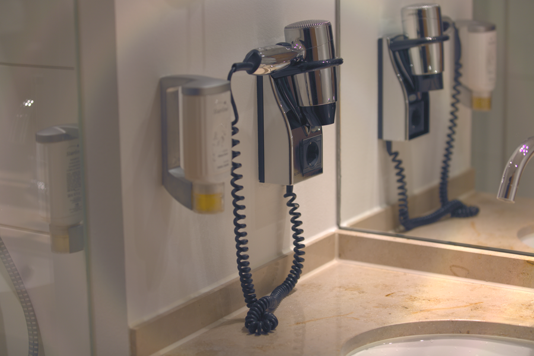

# Stage 16 · NR Chroma 色度降噪

> U/V 的 3×3 中值。



## 这一节在做什么

- 人眼对色度分辨率低，可以比亮度更激进。
- 中值去孤立彩色噪点。
- 太强会让颜色边界渗色。

## 跑一跑

```bash
./build/isp_16_nr_chroma out/15_contrast_brightness.isp out/16_nr_chroma.isp --strength 0.4
```

## 实验

强度 0/0.5/1 对比彩色噪点。

---

**上一节** → [Stage 15](../15_contrast_brightness/README.md)  
**下一节** → [Stage 17](../17_hue_saturation/README.md)
