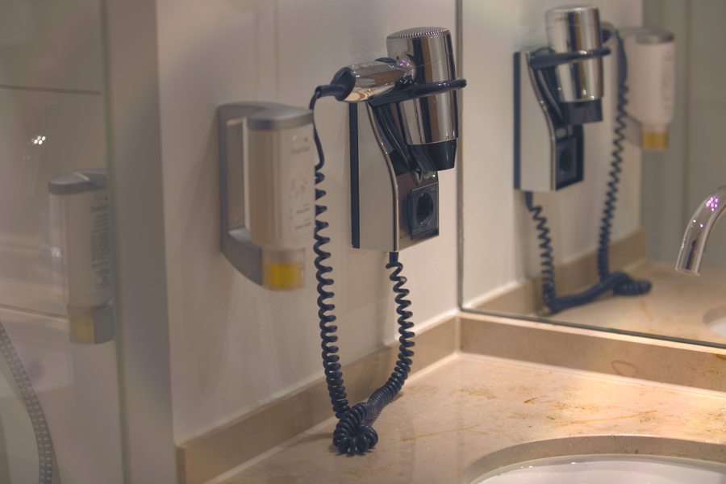

# Stage 17 · Hue/Saturation 色调饱和

> 旋转 (U,V) 并缩放饱和度。



## 这一节在做什么

- u'=(u cosθ - v sinθ)·sat。
- v'=(u sinθ + v cosθ)·sat。
- Y 不变，只改色度。

## 跑一跑

```bash
./build/isp_17_hue_saturation out/16_nr_chroma.isp out/17_hue_saturation.isp --sat 1.08
```

## 实验

sat 0.5/1/1.5；hue ±30° 看肤色。

---

**上一节** → [Stage 16](../16_nr_chroma/README.md)  
**下一节** → [Stage 18](../18_scale_crop/README.md)
