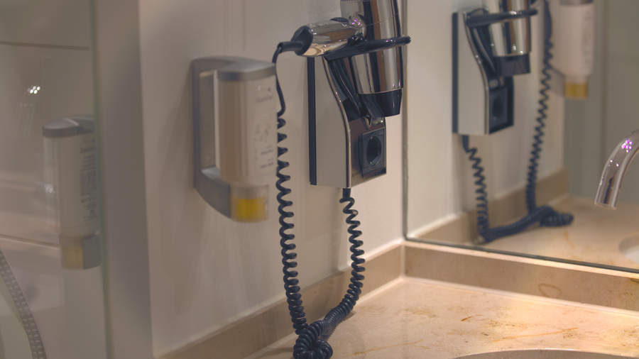

# Stage 18 · Scale & Crop 缩放裁剪

> 最后再缩放，避免中间反复重采样。



## 这一节在做什么

- 支持 1/2、1/4 box 平均。
- --crop 中心裁成 16:9。
- 缩放放在 YUV 域。

## 跑一跑

```bash
./build/isp_18_scale_crop out/17_hue_saturation.isp out/18_scale_crop.isp --scale 0.5 --crop
```

## 实验

0.5/0.25 对比细节；--crop 与不裁对比构图。

---

**上一节** → [Stage 17](../17_hue_saturation/README.md)  
**下一节** → [Stage 19](../19_encoder/README.md)
