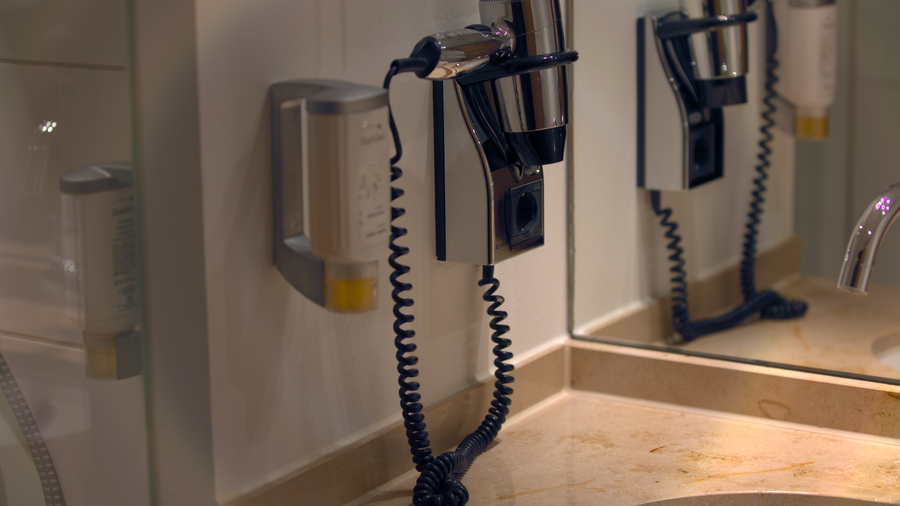

# Stage 19 · Encoder 输出 PNG/YUV

> YUV→RGB 写 PNG；可选 YUV420。



## 这一节在做什么

- R=Y+1.5748V。
- G=Y-0.1873U-0.4681V。
- B=Y+1.8556U。
- --yuv 写 YUV420 planar。

## 跑一跑

```bash
./build/isp_19_encoder out/18_scale_crop.isp out/final.png --yuv
```

## 实验

看 PNG/YUV 文件大小；用 ffmpeg 读 YUV420 确认格式。

---

**上一节** → [Stage 18](../18_scale_crop/README.md)  
**下一节** → [课程首页](../../README.md)
